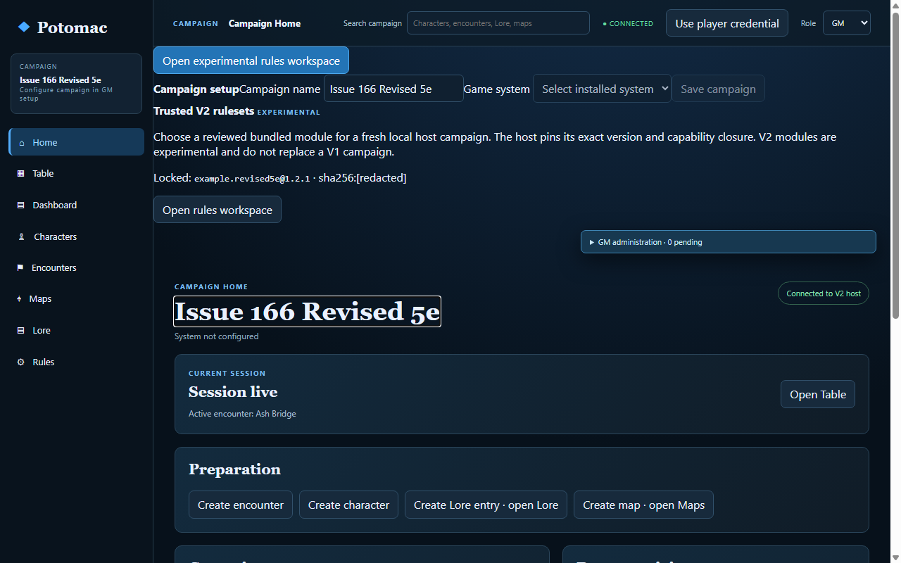
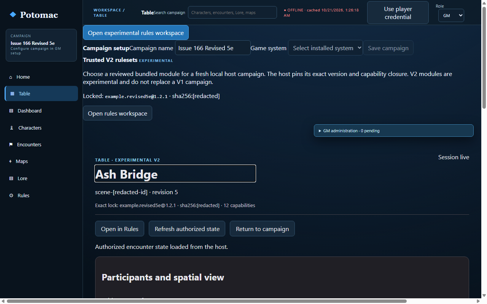
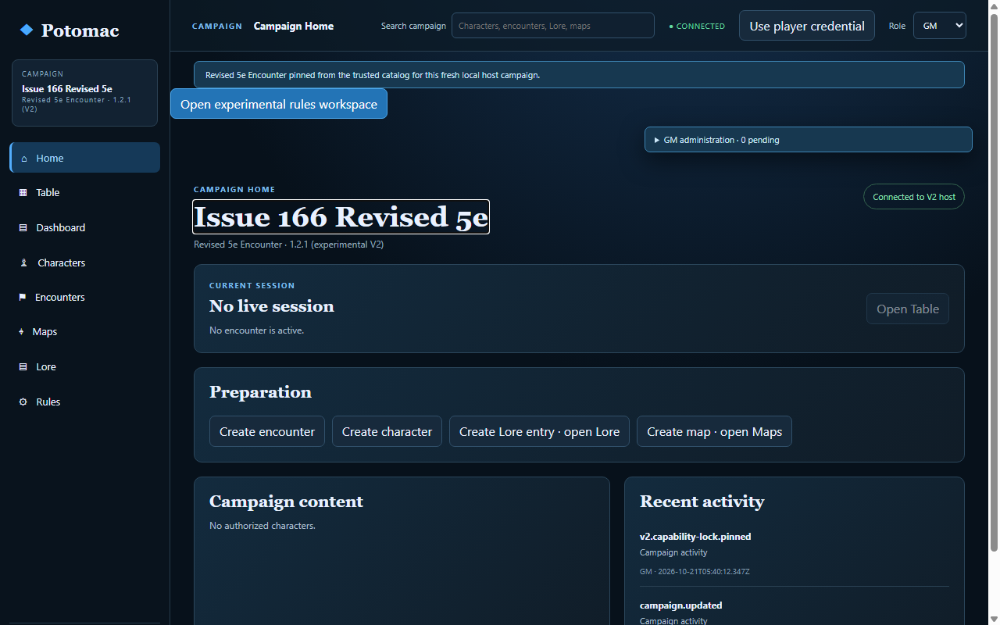
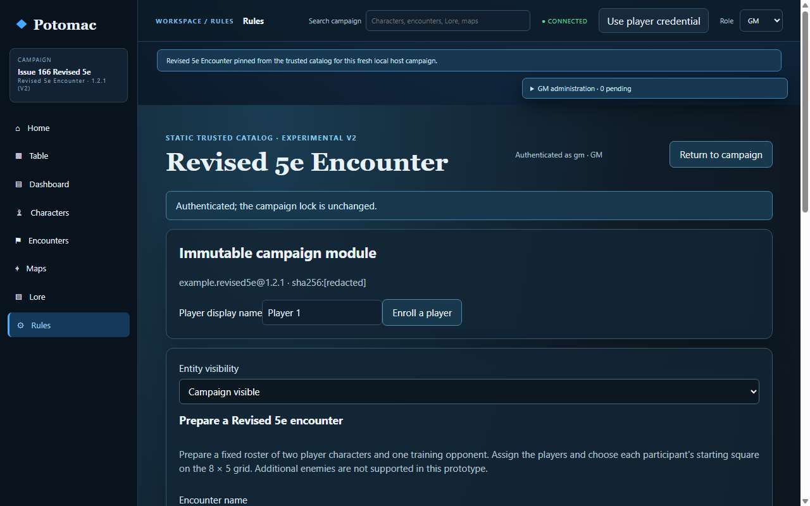
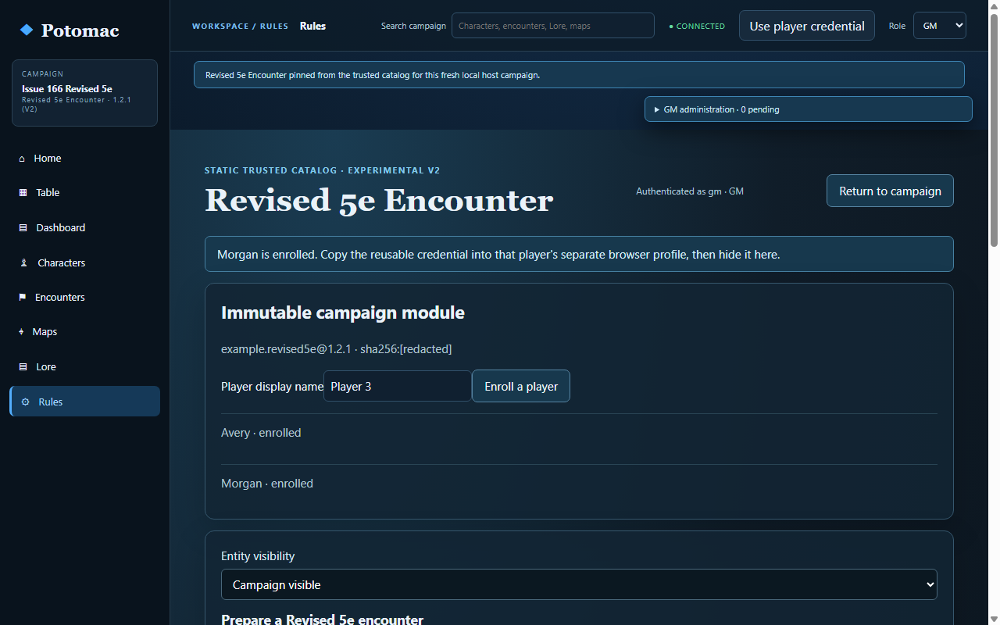
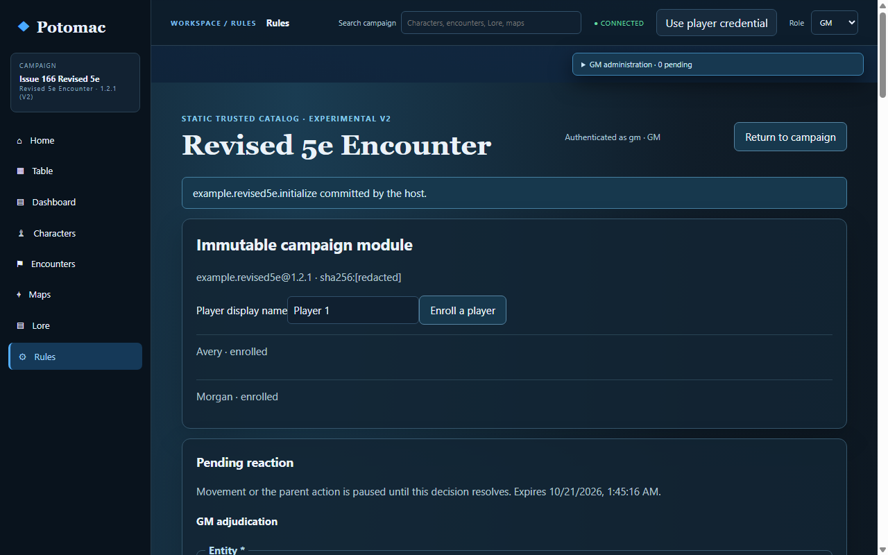
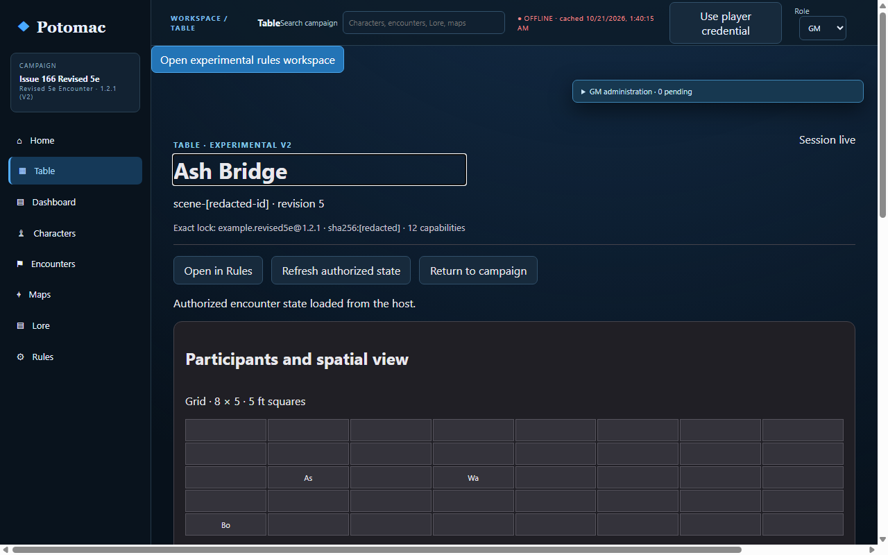

# GM first-run usability assessment — main baseline

Assessment date: 2026-10-21. This is autonomous agent-based usability work, not human usability validation.

## Baseline correction

The obsolete PR #182 baseline was `feat/issue-135-reaction-windows` at `7e0d372`, 35 commits behind `main`. It incorrectly treated Revised 5e and combat as absent. This assessment started from a fresh worktree at `origin/main` (`6bb506b89f9d8c67d680440695a4b9618fa30887`) and a fresh disposable V2 playtest. Main includes the local launch helpers, V2 campaign setup and exact campaign lock, the trusted Revised 5e 1.2.1 module, the Rules workspace, the V2 Table projection, attacks, movement, reactions, and host-owned session lifecycle.

## Independent baseline walkthrough

The source-blind agent used visible application controls. It selected and pinned the exact Revised 5e 1.2.1 module, enrolled two players, prepared an encounter with two player characters and the starter Training opponent, rolled initiative, resolved attacks and movement, adjudicated an opportunity attack, reviewed the Table, finished the session, and returned to Campaign Home. The agent could not authenticate two genuinely independent profiles through its available browser surface.

Observed confusion and limits:

- The active system could be falsely shown as unconfigured on Campaign Home because that screen read the legacy V1 campaign lock instead of the authoritative V2 lock.
- The global Table landing showed no V2 encounter choice; the usable route was Rules → Open in Table.
- Starting squares could not be changed during preparation or in the read-only Table.
- The preparation form supported only the starter opponent; adding more enemies was unavailable in this prototype.
- The GM reaction queue required a manual authorized-state refresh before it appeared.
- The Rules workspace did not identify the current turn. Out-of-turn movement produced generic rejection feedback. Movement on the current actor's turn and opportunity-attack resolution worked.
- The agent's browser surface did not save its own screenshots. The baseline screenshots below were therefore captured separately by the existing Chromium acceptance runner against an unmodified `origin/main` worktree; no credentials appear in those images.

Baseline screenshots:

## Focused refinement

- Campaign Home and the campaign rail now identify the exact trusted V2 module and version when the host reports a V2 lock. A valid V2 campaign no longer displays the legacy “System not configured” warning or empty V1 setup form.
- V2 enrollment asks for player display names and provides copy and hide actions with separate-profile handoff guidance. The existing host enrollment endpoint and member authorization remain authoritative. The general player credential prompt is now a labeled password-style dialog that reports authentication errors accessibly.
- Revised 5e preparation explains that this prototype has two player characters and one training opponent. It adds bounded starting-square controls for all three combatants; the Table remains a read-only view of host-projected state.
- The V2 Table landing explains the Rules → Table route and links directly to encounter selection.
- The GM Rules workspace refreshes the authorized reaction and current-session projections every two seconds through the existing host routes. Role filtering, the exact campaign lock digest, and host adjudication remain unchanged.

Revised screenshots, captured with credentials hidden:

## Remaining limits

- The starter preparation template has exactly one opponent. Additional enemy creation/roster management is unsupported; this increment does not add a monster compendium or battle-map editor.
- Table position editing is unsupported; initial positions are set in Rules preparation, and Table displays them read-only.
- Independent UI agents could not access separate visible Chromium profiles in their browser runtime. The baseline agent did complete visible GM setup, enrollment, encounter preparation, combat actions and reaction adjudication, Table review, session finish, and return to Campaign Home, but it could not authenticate two separate profiles or save its own screenshots. The post-change source-blind agent confirmed the exact ruleset and enrollment UI, then stopped before character assignment for the same profile-access limitation. These are incomplete independent usability walkthroughs, not successful retests.
- Separately, the focused Chromium acceptance runner passed using actual Chromium and two isolated player contexts. It exercises the revised visible workflow and verifies host-owned initiative and attacks, position selection, attack/movement, automatic opportunity-attack refresh and authorized adjudication, session completion, and GM/player filtering. This is functional acceptance evidence, not independent usability validation; the agent could not independently repeat every original objective through visible controls, including two full combat rounds.
- Current-turn guidance and specific out-of-turn error feedback remain follow-up candidates. They do not prevent a GM from resolving combat when acting with the current participant.

## Retest results

| Objective | Source-blind walkthrough | Focused Chromium acceptance |
|---|---|---|
| Confirm exact Revised 5e lock | Completed before and after refinement | Passed; exact module ID, version, and digest are checked |
| Enroll two players | Completed before and after refinement | Passed; copy/hide credential handoff and hidden-credential screenshot covered |
| Authenticate independent player profiles | Blocked by subagent browser runtime | Passed in isolated Chromium contexts |
| Prepare two PCs and starter enemy | Completed in baseline walkthrough; post-change walkthrough stopped at profile assignment | Passed with bounded start-square inputs |
| Add enemies or edit positions in Table | Confirmed unsupported in the starter UI; preparation now sets initial squares | Confirmed fixed one-opponent roster; Table remains read-only |
| Run two full rounds, attacks, movement, and reaction | Actions/reaction completed in the baseline walkthrough; two full rounds were not independently established | Combat/reaction behavior and permissions passed; two full rounds were not claimed |
| Review, finish session, return to prep | Completed in baseline walkthrough | Passed in browser acceptance, including session finish and Table/Rules navigation |

The post-change comparison therefore shows improved lock clarity, credential handoff controls, and preparation/Table routing in captured UI and functional acceptance, but no complete source-blind before/after task-completion comparison. The browser runtime limitation prevented that independent retest.

## Validation record

See the replacement PR description for exact command results, final commit, hosted GitHub Actions run, and the fresh source-blind retest outcome. The browser acceptance harness uses visible application controls for workflow steps and host requests only for assertions; the independent walkthrough did not use the harness or application APIs.
