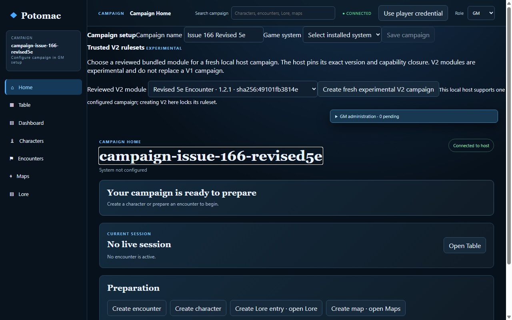
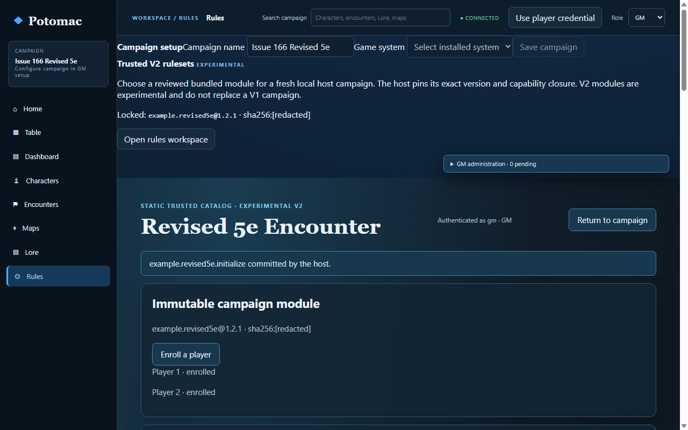
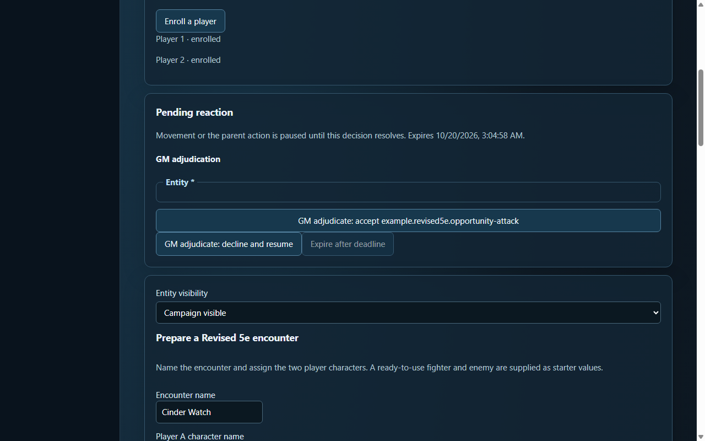
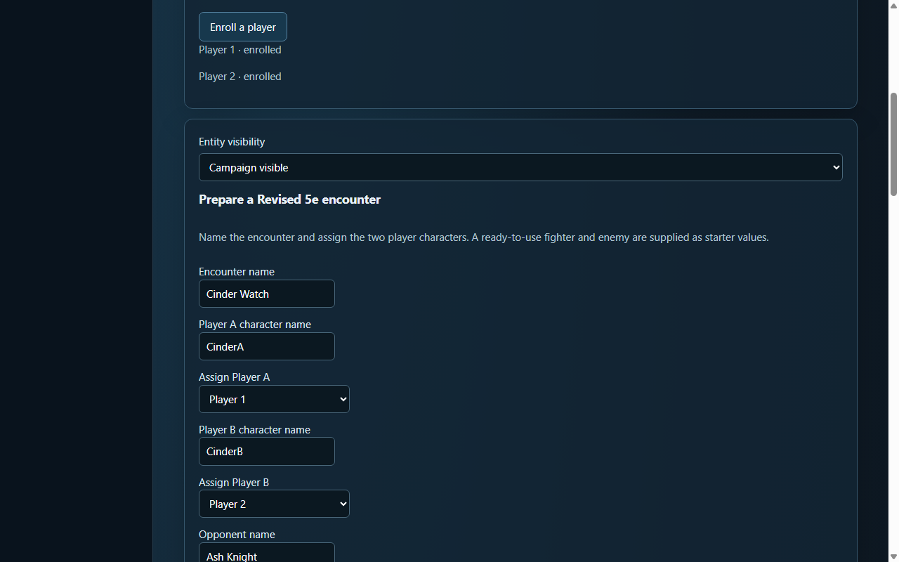
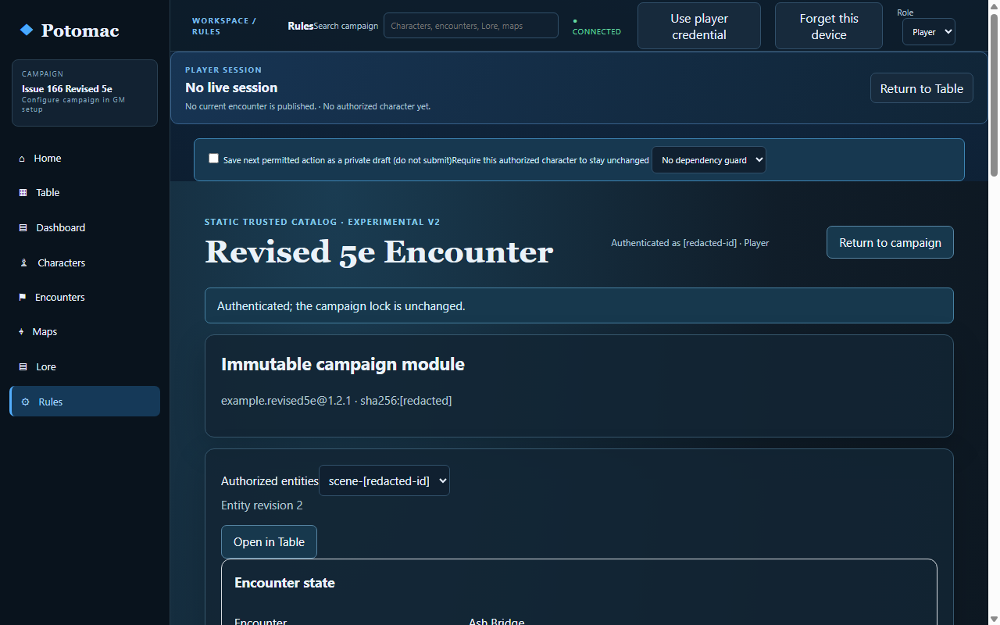
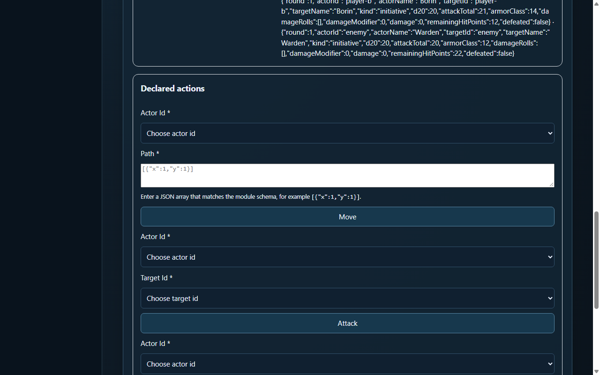
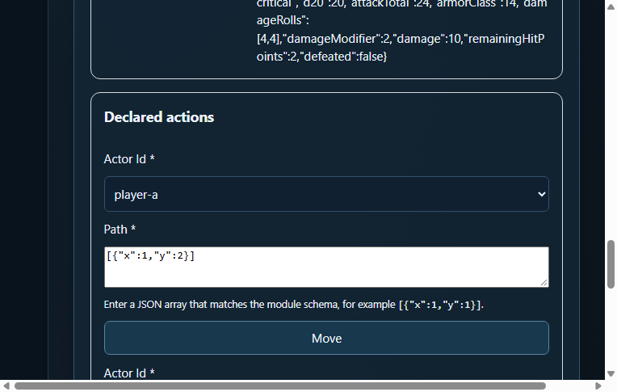
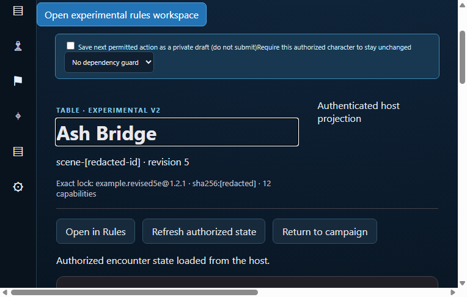

# Revised 5e encounter usability assessment

**Assessment date:** 2026-10-20  
**Code under review:** `origin/main` at `60184b3e9b2dfb77791a1d32f34d14e8ac23a2d6` (merged PR #174)  
**Environment:** fresh disposable single-campaign loopback V2 host; headless Chromium; independent GM, Player A, and Player B browser contexts. The fresh walkthrough started at ordinary Campaign Home, used the visible trusted-module/setup/preparation flows, and used host API reads only for authoritative-state assertions and rejection/retry checks. Exact Revised 5e and Dice-pool locks are saved next to the evidence.

## Result and limits

The automated walkthrough completed the Revised 5e preparation, enrollment, Rules and Table navigation, initiative, attacks, movement, accepted opportunity attack, host restart/reconnect, retry and privacy checks. The host state stayed authoritative and the accepted attack plus resumed movement resolved correctly. The GM screen clearly distinguishes the final accepted/resolved result. The separate Dice-pool non-grid walkthrough from PR #174 remains applicable as the contrast smoke.

This combines an automated Chromium run with model-assisted visual inspection of the rendered GM/player screenshots; that inspection is not a human usability test. No human GM or player participated. No physical device, real network, human keyboard-only participant, or screen reader was used. Those observations remain pending. The new run is reproducible with `POTOMAC_EVIDENCE_DIR=docs/evidence/issue-110-usability-2026-10-20 pnpm acceptance:v2-rules-workspace-browser`; existing `node scripts/v2-ui-browser-acceptance.mjs` also passed its generic V2 accessible-label, keyboard validation/submission, and 390px layout assertions. That generic automation does not establish Revised 5e human or assistive-technology usability.

## Role observations and screenshots

### GM

- Campaign Home exposes the trusted V2 module and exact pinned lock, but the legacy setup shell remains prominent and says “System not configured” after Revised 5e is pinned. Preparation is possible, though the two setup/status surfaces compete for attention.
- A durable movement reaction is not presented in the GM Rules view until the GM clicks **Refresh authorized state**. Before refresh, the page has no pending-reaction control or opportunity-attack notice (`gm-pending-before-refresh-observation.json`); after refresh, the reaction card names the pending action, explains that movement is paused, shows expiry, and offers explicit accept/decline. That feedback is useful once the GM finds it.
- The accepted result says “GM accepted …; host resolution is resolved.” This clearly communicates a completed host resolution rather than only a recorded choice.
- The no-input adjudication form visibly renders an empty required-looking “Entity” field above its accept button. The action still works, but the blank field is confusing noise.

### Player

- The module exposes named actions and displays HP, movement remaining, and other declared resources. However, actor/target controls are labeled “Actor Id” and “Target Id”; enum choices use identifiers such as `player-a` and `enemy`, not the character names visible elsewhere. The player must translate between separate displays and infer which identifier is theirs.
- Move requires the player to enter a JSON array of coordinate objects in a textarea. Its placeholder teaches JSON syntax, not which squares make a legal path. This is technically explicit but requires schema knowledge and offers no waypoint selection.
- The global Player Session strip reports “No live session,” “No current encounter is published,” and “No authorized character yet” while the V2 Rules panel below it contains the authorized Revised 5e encounter and player actor. The page is navigable, but its status contradicts the screen the player is using.
- After host restart the global header can say “OFFLINE · cached” while the V2 Table child says “Authenticated host projection” and shows the refreshed host revision. These two surfaces do not tell users which connection/source the offline label describes.
- Rules/Table/Return buttons are present and the exercised return path retains the selected entity. On the Table screenshot, the global setup controls remain above the V2 table, adding unrelated material to the play surface.

## Severity-ranked findings

| Priority | Finding | Evidence and existing tracking |
| --- | --- | --- |
| **P1** | **Movement requires raw JSON and technical actor identifiers.** The primary Move form asks for `[{"x":1,"y":2}]`; action selectors expose internal IDs instead of character names. That makes a central turn action hard to discover and increases invalid-input/ownership mistakes. | Repro: open Rules, inspect Move and Attack forms, compare dropdown values with the authorized actor cards. Screenshots: `player-a-move-form.png`, `player-a-rules.png`; module descriptors in `examples/example.revised5e/v2/ui/combat.json`. Track in #110 findings and #113 polish; action/target discovery also relates to #112. |
| **P1** | **V2 player status is misleading.** The V1 session strip claims no live/published encounter and no authorized character while V2 Rules/Table has an authorized encounter; the outer shell may say offline/cached while the V2 child reports an authenticated projection. This can make players doubt whether their character or state is current. | Repro: complete Campaign Home enrollment/assignment, then open V2 Rules and Table; inspect the Player Session strip and top connection badge against the V2 entity/revision. Screenshots: `player-a-rules.png`, `player-a-table-grid.png`. Track in #112 and #113. |
| **P1** | **Pending GM reactions require manual refresh.** The durable reaction exists on the host, but the GM sees no pending action until explicitly refreshing authorized state. During play this can stall movement without drawing attention to the GM. | Repro: have Player A move out of reach, leave GM Rules untouched, inspect `gm-pending-before-refresh-observation.json`; then click **Refresh authorized state** and inspect `gm-opportunity-attack-controls.png`. Track in #110/#111. |
| **P2** | **The V2 tabletop is surrounded by unrelated setup/status UI.** Campaign setup and global session strips remain visible in the Rules/Table experience; enrollment labels are generic Player 1/2, and the no-input GM reaction form shows a blank “Entity” field. | Screenshots: `gm-campaign-home.png`, `gm-opportunity-attack-controls.png`, `gm-table-grid.png`. Track in #111/#113. |
| **P2** | **Narrow/keyboard evidence is generic, not Revised 5e specific.** The shared V2 UI browser suite passes its keyboard and 390px assertions, but this run did not validate the complete Revised 5e encounter flow at 390px or with a human keyboard-only user. | Keep that scope explicit under #113/#114; no device or assistive-technology claim. |

**P0:** none found in this assessment. The #172 correctness failure is repaired and closed; current host acceptance confirms reaction effects and movement remain consistent. No duplicate issues were created because the remaining findings map to open #110–#114.

## Smallest useful V2 session lifecycle

The screens demonstrate why V2 needs a host-owned current-session context: the V2 encounter can be prepared, played, restarted, and projected while Campaign Home and Player Session still describe only the legacy V1 session state. Revised 5e's module encounter status (`setup`, `active`, `complete`) is useful combat state, but it is not a campaign/table session status and cannot supply accurate generic Dice-pool or other module status.

For a first playable V2 loop, **start and finish are necessary**: the GM needs an explicit way to make one prepared V2 encounter the current table session, and a clear way to end it and return to preparation. **Pause/resume are not necessary for the first increment**: restart/reconnect already preserves the encounter; adding pause without host-wide command/reaction gating would create an ambiguous state. If a later increment offers pause, it should offer resume as its paired transition and define what happens to pending reactions and new commands while paused.

Minimum host-owned model within the existing single-campaign boundary: one current session reference with stable session ID, encounter entity ID, `active|finished` status, revision/timestamps, and idempotent command receipts/events. GM start/finish commands must validate campaign, current exact module lock, entity revision and absence of an incompatible pending continuation. Player projections must receive only the safe session status and the encounter/character they are authorized to see. Campaign Home, Rules and Table should render this one projection; keep it separate from module-specific combat/scene status. Do not add multiple campaigns, a generic lifecycle framework, or offline session mutation.

## Issue reconciliation and proposed increments

- **#110 remains open.** The requested human GM/Player A/Player B walkthrough and human Dice-pool contrast are not complete. This document covers only automated Chromium plus screenshot review.
- **#111 remains open.** Use its preparation/session-flow scope for the host-owned V2 start/finish context and later live reaction notification.
- **#112 remains open.** Use it for truthful V2 authorization, current encounter, connection, and return-navigation status.
- **#113 remains open.** Use it for module-labelled choices, guided movement input, labels/empty states, narrow-layout and keyboard follow-up.
- **#114 remains open.** Physical-device, real-network and human screen-reader evidence is still pending.
- **#172 is closed** with merged acceptance evidence recorded in its issue comment. No additional issue is warranted by this pass.

Recommended implementation order, by direct GM/player benefit:

1. **V2 current-session projection with Start and Finish** (#111/#112). High benefit: makes active ownership/session state truthful across Campaign Home, Rules, Table, and Players. Medium scope; medium-to-high regression risk because it touches host authorization, revisions, and projections. Acceptance: start the selected V2 entity through Campaign Home/Table; exactly one current session; Player A/B see correct authorized session/character; restart/reconnect preserves it; finish is idempotent and returns to preparation; stale, unauthorized, changed-retry, and pending-continuation cases reject atomically. No pause/resume in this increment.
2. **Human-readable action choices and guided movement waypoints** (#110/#113). High benefit: players select their named authorized actor/target and select legal route squares without hand-authoring JSON. Medium scope; medium renderer risk. Acceptance: generic module-owned descriptors supply safe labels; generic renderer displays friendly actor/target names and an accessible waypoint editor; host remains authoritative for ownership, turn legality, occupancy, range and revisions; keyboard and narrow viewport tests plus exact/altered retry regressions pass.
3. **Authorized pending-reaction notification** (#110/#111). High benefit: removes the GM's need to poll manually. Medium scope; medium-to-high event/privacy risk. Acceptance: authorized GM receives a bounded refresh/event when the durable reaction opens/resolves; unauthorized players receive no hidden action/window details; reconnect and missed-event recovery converge on the authoritative host projection; duplicate notification cannot duplicate adjudication.

No implementation changes are part of this assessment.
