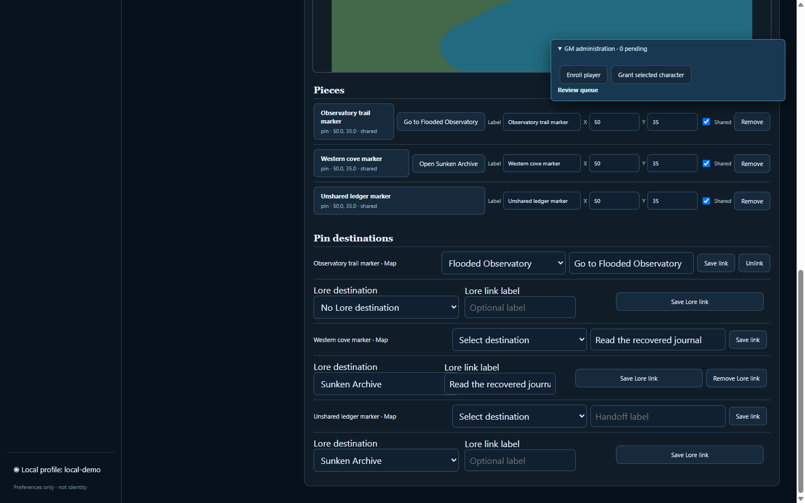
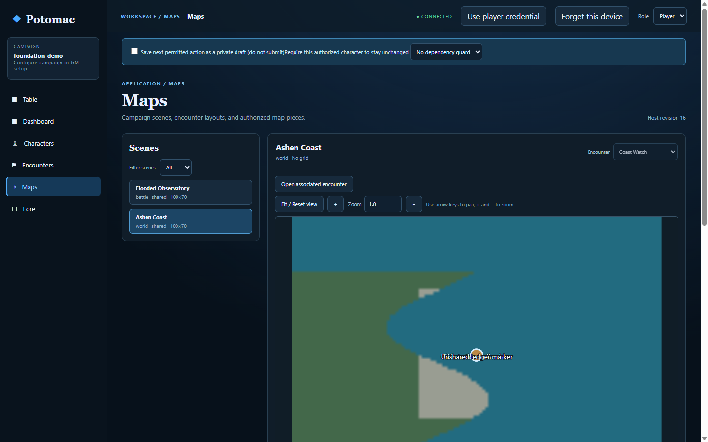
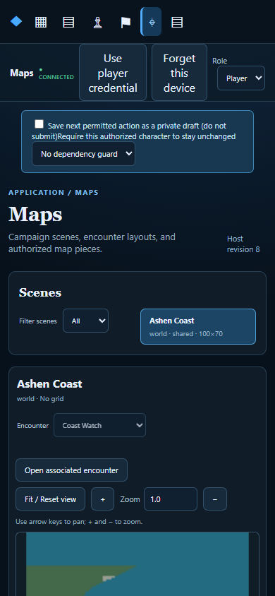

# Potomac v0.7 Maps closeout QA record

Date recorded: 2026-10-13 (America/New_York). Scope: v0.7 Maps release closeout tracked by [#85](https://github.com/chrspickens/Potomac/issues/85), under [milestone tracker #69](https://github.com/chrspickens/Potomac/issues/69).

This record separates reproducible automated browser coverage, CI, reported human visual review, and hardware/network checks. The browser acceptance uses real Chromium UI interactions and isolated disposable hosts, databases, asset stores, and browser contexts. It does not modify production campaign data. A browser automation PASS is not a claim of physical-device or human visual acceptance.

## Flooded Observatory ten-stage journey — VERIFIED (automated)

The complete PR #82 run is recorded in [Flooded Observatory run report](maps-v07-flooded-observatory-run-2026-10-13.md) and the issue matrix in [v0.7 validation report](maps-v07-validation-2026-10-13.md). The underlying disposable Chromium screenshots and sanitized traces are in [`docs/evidence/maps-v07-browser/`](evidence/maps-v07-browser/).

| Stage | Result | Evidence |
|---|---|---|
| 1. GM bootstraps and creates Ashen Coast through the React UI; connection remains stable | VERIFIED | `stage-1-ashen-coast.png`, `connection-table-15s.png`, GM Chromium trace; accepted create/readback is recorded in the report. |
| 2. Two players independently enroll and use separate Chromium contexts | VERIFIED | Player A/B traces and initial screenshots; GM enrollment and player credential-entry performed through UI. |
| 3. Create Ashen Coast World Map and Flooded Observatory Battle Map; upload images and configure grids | VERIFIED | GM creation screenshot; World grid disabled and Battle square grid; uploaded fixture bytes checked exactly (304/459 bytes). |
| 4. Add/edit tokens and private pin, associate encounter, publish and verify privacy | VERIFIED | GM token/private-pin screenshots, keyboard/pointer screenshot; player DOM, HTTP, image and SSE/replay assertions; private content absent. |
| 5. Navigate World ↔ Battle without changing active encounter | VERIFIED | Both players navigate through the UI; active encounter invariant asserted. |
| 6. Workspace pinned/following bindings | VERIFIED | GM Workspace screenshot shows pinned World scene and encounter-following scene behavior through encounter changes. |
| 7. Offline cached map/image, reload/navigation, revocation and reconnection | VERIFIED (simulated browser network isolation) | Player A offline/revocation screenshots and trace; CDP blocked app-host requests, cached stale/read-only content rendered, reconnect refreshed authorization. This is not an actual Wi-Fi/router interruption. |
| 8. Host restart persistence | VERIFIED | Graceful host shutdown/restart and subsequent state checks for maps, settings, pieces, links, associations, permissions and images; covered in GM trace/report. |
| 9. Portable v5 backup/restore | VERIFIED | Restored into an empty disposable host; records and exact image bytes checked; screenshot `gm-after-v5-restored-host.png`. |
| 9. Keyboard, focus retention, numeric positioning, pointer edit and narrow viewport | VERIFIED (automated) | `gm-keyboard-and-pointer-token-edit.png`; `player-b-narrow-viewport.png`; 390×844 layout/no-horizontal-overflow assertion. |
| 10. System B Maps journey | VERIFIED (automated) | `system-b-starboard-deck-ui.png`, System B trace, pinned-system fixture regression. |

The automated run outcome is PASS. Detailed test counts and runner command are preserved in the report. The automated acceptance does not exhaust every boundary in the normative requirements (for example, every upload quota/corruption boundary or every map-kind link permutation); see the requirements and issues for those broader cases.

Closeout rerun from the documentation branch, based on `main` commit `c3c3a1c`: `pnpm acceptance:maps-browser` PASS (exit 0; stages 1–10 and 8b all reported PASS), and `pnpm check` PASS (exit 0; build, 123 Node tests, debug smoke, and all acceptance commands including the complete Maps browser scenario). The rerun wrote sanitized diagnostics to the local temporary file `potomac-maps-browser-diagnostics-28216.json`; the integrated `pnpm check` run wrote `potomac-maps-browser-diagnostics-38616.json`. These temp diagnostics are not repository artifacts; committed screenshots and traces below are the durable evidence.

Selected screenshots:

Sanitized Chromium traces: [GM](evidence/maps-v07-browser/gm-chromium-trace.json), [Player A](evidence/maps-v07-browser/player-a-chromium-trace.json), [Player B](evidence/maps-v07-browser/player-b-chromium-trace.json), and [System B GM](evidence/maps-v07-browser/system-b-gm-chromium-trace.json).

## Browser stabilization and CI — VERIFIED

- [PR #82](https://github.com/chrspickens/Potomac/pull/82) merged. Its PR-branch Checks run [#38489945680](https://github.com/chrspickens/Potomac/actions/runs/38489945680) completed with success.
- The first post-merge run after #82, [#38490209529](https://github.com/chrspickens/Potomac/actions/runs/38490209529), failed at Stage 4 after passing Node tests and browser stages 1–3: the harness clicked publish before the intended map selection had rendered. [PR #83](https://github.com/chrspickens/Potomac/pull/83) fixed that real-browser timing race by waiting for the intended World Map selection and enabled publish control; it retained the assertion and did not change product code or permissions. The specifically requested post-merge `main` Checks run [#38490851288](https://github.com/chrspickens/Potomac/actions/runs/38490851288) completed with success.
- [PR #86](https://github.com/chrspickens/Potomac/pull/86) implemented authorized Map-pin → Lore navigation. Its PR Checks run [#38495592380](https://github.com/chrspickens/Potomac/actions/runs/38495592380) completed with success. The latest post-merge `main` Checks run for merge commit `c3c3a1c` is [#38502194570](https://github.com/chrspickens/Potomac/actions/runs/38502194570), completed with success. These run states and conclusions were queried from GitHub during this closeout on 2026-10-13 America/New_York (the listed run timestamps are UTC).

## Map → Lore integration — VERIFIED (automated)

The [PR #86 acceptance report](maps-v07-map-pin-lore-acceptance-2026-10-13.md) records the implemented and tested extension: GM-created Sunken Archive Lore linked from Ashen Coast; GM can select/change/remove the link; Player A/B follow Map → Lore → Back without changing the active encounter; private/unpublished/archived/missing/revoked Lore destinations are filtered; restart and v5 restore preserve the relation and exact image bytes; offline authorization refresh removes revoked content from the refreshed projection. Raw HTTP/state/SSE/replay, direct IDs, DOM, and offline cache assertions supplement the actual UI journey.

| Criterion | Result | Evidence |
|---|---|---|
| GM creates Lore and links/changes/removes destination through Maps UI | VERIFIED | PR #86 report, GM screenshot and trace, host/UI regression coverage. |
| Two independent players navigate Map → Lore → Back; encounter unchanged | VERIFIED | PR #86 report and Chromium browser run assertions. |
| Unauthorized destination metadata absent from HTTP/SSE/replay/DOM/offline refreshed projection | VERIFIED (automated) | PR #86 report and `server/host/maps.test.mjs`; privacy assertions inspect raw responses and rendered DOM. |
| Restart and v5 preserve the authorized relationship and image bytes | VERIFIED | PR #86 report, separate empty-host restore and byte comparison. |
| Physical phone/tablet visual and touch behavior | NOT VERIFIED | Narrow Chromium viewport, keyboard and pointer automation are not physical-device acceptance. |

## Human and physical QA boundary

| Check | Status | Notes / recommendation |
|---|---|---|
| Positive human visual review | VERIFIED (user-reported) | The user confirmed the application looked good / satisfactory visual review in the closeout discussion recorded on issue #85. This is not an independent or per-device visual audit; automated screenshots remain available for review. |
| Physical touchscreen gestures (tap, pan, pinch/zoom, drag, target sizing) | NOT VERIFIED | No physical touch device was used. Recommend DEFERRED until a maintainer explicitly approves the deferral or hardware QA can be performed. CDP pointer events do not count. |
| Real Wi-Fi/router/network loss and recovery | NOT VERIFIED | Browser-level request blocking was used for offline acceptance; no physical network interruption occurred. Recommend DEFERRED pending explicit maintainer approval or a real network test. |
| Device/browser-specific storage, viewport and accessibility behavior | NOT VERIFIED | Automated checks used Chromium on the available environment; no physical phone/tablet or browser matrix is claimed. Recommend DEFERRED pending explicit approval or device coverage. |
| Screen-reader announcements / assistive technology | NOT VERIFIED | Keyboard/focus automation ran; no screen reader was exercised. |

Deferral is recommended, not yet recorded as maintainer-approved. Therefore this record does not itself satisfy the close gate in #85/#69, and neither issue should be closed on its basis alone.

## Separate historical QA gaps

- [#67 — captured historical v2/v3 archive restore](https://github.com/chrspickens/Potomac/issues/67) remains open. Synthetic fixture coverage is not evidence from genuine exports produced by historical releases; it remains a separate archive-compatibility verification gap.
- [#68 — residual Lore human/offline/backup QA](https://github.com/chrspickens/Potomac/issues/68) remains open. Maps/Lore automated tests do not complete its human three-profile Lore/offline/cache and v4 restore checklist. Keep it separate from #85 and the v0.7 Maps acceptance claims.

## Closeout recommendation

The v0.7 Maps implementation and automated browser/CI gates are complete on current `main`. Merge the focused documentation closeout only after review. Keep #85 and parent #69 open until a maintainer explicitly approves deferring physical touch, real network-loss, and device-specific checks (or those checks are completed), and post-merge `main` CI for the documentation PR is green. Do not treat that milestone decision as resolving historical #67/#68.
