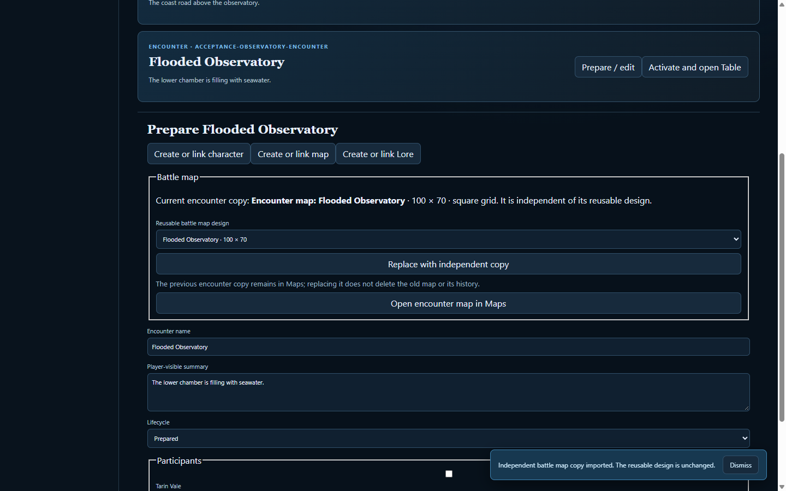

# Map collections and encounter imports — automated validation

Date: 2026-10-24. Scope: split Maps into World Maps and Battle Map Designs; import a reusable Battle Map into Encounter preparation as an independent host-owned copy.

## Results

- `node --test server/host/maps.test.mjs` — PASS (3 tests), including import retries after host restart, imports into two encounters, source/copy independence, content-addressed image reuse, stale-association conflict, world-map rejection, and player authorization.
- `pnpm acceptance:maps-browser` — PASS (10 stages), including the GM preparation picker and import action, V1 encounter and session workflow, both map collections, player authorization, offline caches, backup/restore, keyboard/pointer behavior, narrow layout, and System B compatibility.
- `pnpm check` — PASS. This includes build, host/client/V2 tests, debug smoke, all configured HTTP/browser acceptance suites, Revised 5e, Dice-pool, and Tides & Omens browser coverage.
- `git diff --check` — PASS.

The browser test captured the encounter import state:

The screenshot is stored at [`gm-encounter-battle-map-import.png`](evidence/maps-v07-browser/gm-encounter-battle-map-import.png). These are automated checks only; human usability validation has not been performed.
