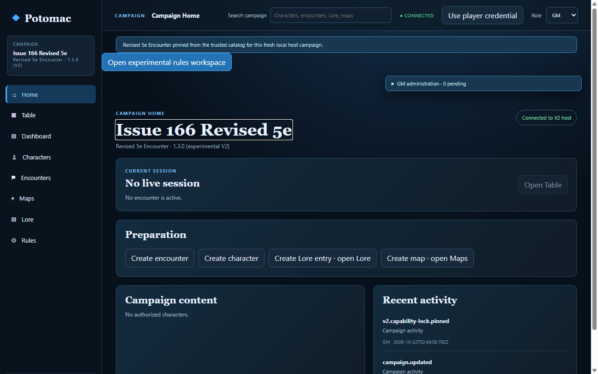
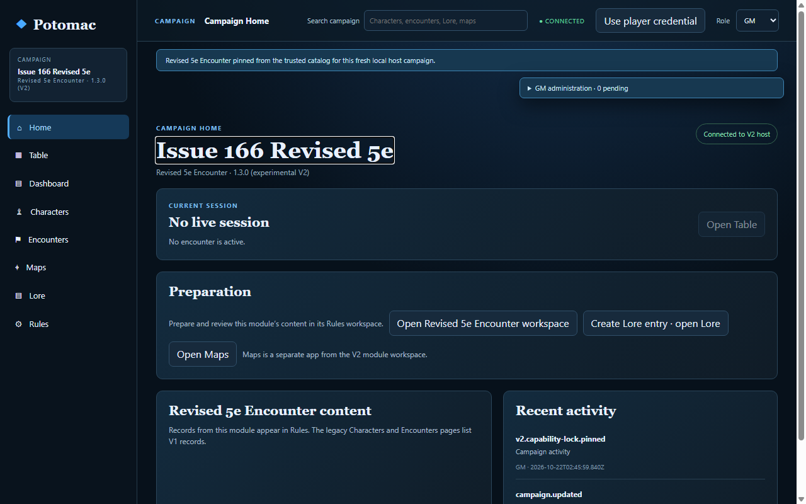

# End-to-end GM experience audit

## Baseline

This refinement is based on `origin/main` at `cdf2d51350eefbc9ee4f6aacc9f7e18893f005f4`, after PR #185 merged. Revised 5e Encounter 1.3.0, the multi-enemy roster, turn tracker, ownership cues, combat feedback and session lifecycle were already present. The exact trusted module lock and combat rules were not changed.

The normal disposable playtest launcher created an isolated V2-enabled host and browser profile. Its default host port was in use by another process, so the playtest used alternate ports; that process and the original checkout were left untouched.

## Independent walkthrough and visible UI evidence

A separate source-blind agent could not start. Its browser inventory had no independent profiles, and the in-app browser refused to open from its thread. It did not inspect the application by another route. No independent agent or human usability validation is claimed.

I continued with visible controls in the disposable app. Campaign Home exposed the trusted Revised 5e 1.3.0 module. After creating the V2 campaign, its **Create encounter** action opened the legacy V1 encounter form, and the legacy Characters page reported no authorized characters. The Maps route opened the separate Maps app. I did not submit the legacy encounter form. Temporary local player credentials were hidden after inspection.

Isolated real-host Chromium acceptance supplied the GM/Player A/Player B functional coverage unavailable to the source-blind agent. It began from Campaign Home, used independently authenticated contexts, prepared and ran Revised 5e combat, verified role separation, and exercised refresh, host restart and session completion. These automated results are functional evidence, not independent usability validation.

## Prioritized findings

| Severity | Finding and evidence | Refinement |
| --- | --- | --- |
| P2 | V2 Campaign Home offered V1 **Create encounter** and **Create character** actions. Clicking **Create encounter** visibly opened the legacy V1 form. | V2 Home now routes preparation to the pinned module workspace and no longer advertises those legacy creation actions. |
| P2 | Campaign Home used the V1 snapshot for its character preview. In a V2 campaign it could say no authorized characters were available even though module-owned records belong in Rules and Table. | V2 Home explains where module records appear; player guidance directs them to the pinned module workspace instead of making a false V1 character claim. |
| P2 | Characters, Encounters and Maps appeared as peer app destinations without explaining their V1 or separate-app scope in a V2 campaign. | Those routes now show a V2 scope note and a direct route to the pinned module workspace. Maps is described as separate from module content. |
| P3 | One baseline run of the broad browser suite reached Dice-pool session completion before the post-restart action button had re-enabled. The app still showed the live session; the helper rejected the disabled button. | The acceptance now waits for the explicit enabled state of **Finish session** after the authorized refresh. This keeps the expectation intact and removes the observed synchronization race. The revised suite passed. |
| P3 | The first hosted run started Vite and Chromium, then failed before Campaign Home with CDP `Inspected target navigated or closed`. The browser target was created and attached, but the runner evaluated the new page before its initial navigation had loaded. | The browser acceptance now waits for the target's explicit `Page.loadEventFired` event before inspecting Campaign Home. The focused suite passed locally after this change; hosted recheck is pending. |
| P3 | The next hosted run reached the player Home assertion, but checked its guidance immediately after the panel appeared, before the host's exact V2 lock projection had finished loading. | The acceptance now waits for the exact lock-derived guidance text before asserting it, matching the app's asynchronous readiness signal. Local focused and hosted rechecks are pending. |

Existing V2 Table navigation already explains that a V2 encounter is selected in Rules rather than through the legacy active-encounter selector. Rules/Table handoff, host session status, exact lock display, and finish/return-to-Home behavior passed existing acceptance and were left intact.

## Changes

- Made Campaign Home’s preparation actions conditional on the authoritative V2 lock. V2 campaigns get a direct workspace action; V1 campaigns keep their existing character and encounter actions.
- Replaced misleading V1 character status and preview content on V2 Home with module-scoped guidance. Players are directed to the workspace where their authorized character and actions are projected.
- Added concise scope notes to legacy Characters, Encounters and Maps destinations in a V2 campaign, with a route back to the locked module workspace.
- Updated browser acceptance to verify the V2 Home and legacy-scope messages, and to wait for the host-confirmed session control to be enabled after refresh.
- Kept host authorization, exact module locks, owner filtering, idempotency, Table/Rules navigation and Revised 5e mechanics unchanged.

## Before and after

The sanitized screenshots are from real-host Chromium runs on the baseline and revised main-based build.

| Before | After |
| --- | --- |
|  |  |

## Supported workflows and remaining limits

Automated real-host Chromium acceptance covers exact Revised 5e 1.3.0 pinning, two enrolled players, two player contexts, an encounter with two characters and three enemies, starting positions, initiative, attacks, movement, an eligible opportunity attack, two rounds, finish, refresh and host restart. It also checks ownership and GM/player separation. Dice-pool’s non-grid session workflow is covered as a regression.

The source-blind agent did not get to try the workflow. Human usability testing remains outstanding. V2 still supports one configured campaign per host, and module upgrades/migrations are unsupported. Revised 5e still has the existing one-eligible-opportunity-attack-responder limitation. The generic UI does not infer action-cost rules that a module has not declared.

## Verification

Results after the final code changes:

- `pnpm acceptance:normal-v2-campaign-browser` — passed with isolated GM/Player A/Player B Chromium contexts and host restart.
- `pnpm acceptance:v2-rules-workspace-browser` — passed with the new home/legacy-scope assertions, Revised 5e combat, session finish and restart, plus Dice-pool regression.
- `node scripts/revised5e-browser-acceptance.mjs` — passed with attacks, movement, opportunity reaction suspension/restart/resume, session completion, ownership and retry checks.
- `pnpm acceptance:dicepool-browser` — passed; non-grid actions, reaction, privacy, idempotency and restart.
- `pnpm build` — passed as part of `pnpm check`; Vite retains its existing >500 kB chunk warning.
- `pnpm check` — passed all unit, host, module, Maps, V1/V2 browser and system acceptance suites.
- `git diff --check` — passed. Generated Maps evidence was restored to the exact main-branch contents; no Maps evidence is included in this change.
- Hosted GitHub Actions — [39713809452](https://github.com/chrspickens/Potomac/actions/runs/39713809452) exposed the initial CDP navigation race; [39714697198](https://github.com/chrspickens/Potomac/actions/runs/39714697198) then exposed the premature player Home assertion. Both are bounded acceptance synchronization issues; the final-head run is pending.
